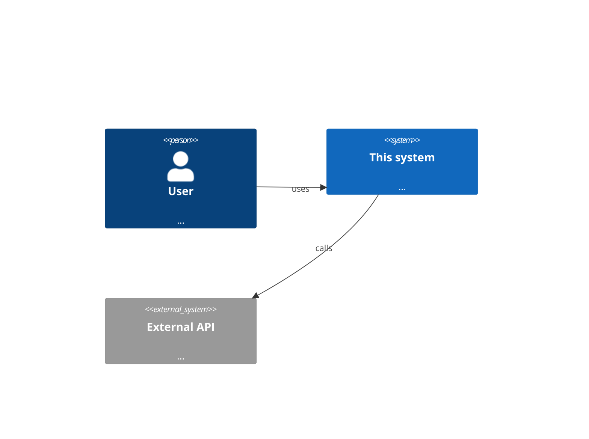
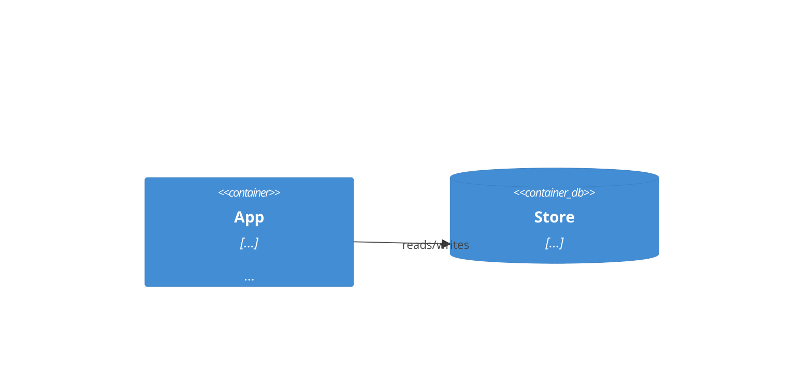

<!-- Drop sections with nothing true to say, rename headings to the repo's vocabulary, fill the rest, and delete every comment as you go. -->

# <System or app name> — Architecture

**Last reviewed:** YYYY-MM-DD · **Owner:** @handle / team · **Describes:** current system | target design

<!-- Link docs/GLOSSARY.md here when it exists: "[GLOSSARY.md](GLOSSARY.md) defines its terms."
Bump the date on every edit. Owner is who answers questions, not who wrote it — from CODEOWNERS,
the README, or AGENTS.md; TBD when none names one.
Keep one Describes value. For target design, mark every part not yet built _(planned)_. -->

## Overview

<!--
PUT: 2–4 sentences. What the system does, for whom, and the one-line architectural style
(e.g. "modular monolith with a separate async worker", "batch pipeline: deterministic
extraction, LLM-written narrative", "library of pure functions behind one public module").
NOT: history, marketing, feature lists.
-->

## System context

<!--
PUT: One diagram — this system as a single box; around it every user role and every
external system it calls or is called by (APIs, warehouses, LLM providers, other workspace
members this one imports). One sentence per external system: what we use it for and the
direction of the dependency. Link sibling members' own architecture docs.
NOT: anything inside the system.
-->



## Public surface

<!--
PUT: Libraries and shared packages only. One bullet per entry point callers may use, named by
what it does, with its contract: what goes in, what comes out, what it guarantees. Say where
the surface ends ("everything outside the root module is private").
NOT: function or class names, signatures, parameter lists.
-->

- **…** — …

## Components

<!--
PUT: One diagram + one bullet per component. A component = anything separately runnable
or deployable (service, worker, scheduled job, CLI, web/mobile app) AND every datastore,
cache, queue, and artifact store.
Bullet format: **name** — responsibility · tech · owns [data] · talks to [x, y] over [protocol].
NOT: internal modules, classes, endpoints. Not Docker-level detail.
-->



- **…** — …

## Key flows

<!--
PUT: 2–4 flows a new engineer will hit first (main request path, pipeline from input to
output, auth, primary write path, main background job). Each: 1-line purpose, then numbered
hops, a stage chain, or a small sequence diagram. Name what crosses each hop and mark where
sync becomes async or deterministic code hands off to an LLM. Note the failure mode if
non-obvious.
NOT: every flow. Not per-endpoint. Not edge cases.
-->

### <Flow name>

1. …

## Data & storage

<!--
PUT: The core entities or artifacts (5–10 max) and which component owns each. Where state
lives. Consistency guarantees (transactional? eventual? idempotency keys? reproducible runs?).
Retention rules if they shape design.
NOT: full schema, column lists, migrations. Link to schema docs / ERD instead.
-->

## Cross-cutting concerns

<!--
PUT: One short paragraph each, only for concerns that exist. How it's done and which
top-level directory owns it.
NOT: how-to guides, config values, secrets, paths below the top level.
-->

- **AuthN / AuthZ** — …
- **Observability** (logs, metrics, traces) — …
- **Error handling & retries** — …
- **Configuration & secrets** — …
- **Deployment & environments** — …

## Codebase map

<!--
PUT: Top-level directories of this doc's scope and how they map to Components and
Cross-cutting concerns. One line each. Dependency direction and layering rules if any
("core has no I/O", "nothing imports from entrypoints"). Replace the example below with
the real layout.
NOT: subdirectories, file names, function or class names, links to source files.
Not file naming conventions (that's CONTRIBUTING).
-->

```text
core/         # business rules, no I/O
adapters/     # database, queue, external clients
entrypoints/  # CLI, HTTP, worker — thin, no business logic
```

## Constraints & non-goals

<!--
PUT: Hard invariants that must not be broken ("all writes go through core", "no
cross-service DB access"). Deliberate non-goals ("not multi-region", "no offline mode").
External constraints (compliance, latency budget, cost cap) that shaped design.
NOT: wishes, roadmap, tech debt lists.
-->

- …

## Decisions

<!--
PUT: One line per decision record in docs/decisions/, newest first. The record-decision
skill adds these lines.
Format: YYYY-MM-DD · <the record's H1 claim> · [record](decisions/YYYY-MM-DD-slug.md)
Undecided questions: "Open: <question>" until a record settles them.
NOT: rationale, alternatives, discussion — that lives in the record.
-->

- …
