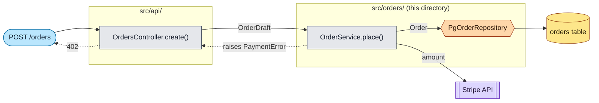

# Notation

How a code README writes the names of code and draws its diagrams, in any language and any kind of repository: a pipeline, a backend API, a frontend, a library. One thing has one written form in prose, tables, diagrams and the code map.

## Names in prose and tables

**Put every code name, path, command and literal value in backticks.**

**End every callable with `()`.** The parentheses mark the kind in every language; capitalisation cannot, since a Go function and a TypeScript class are both `PascalCase`.

**Leave the arguments out, unless the sentence is about one**: `build_setup(created_on=…)`.

| Thing                                                                                                    | Written as                                        | Examples                                                                                           |
| -------------------------------------------------------------------------------------------------------- | ------------------------------------------------- | -------------------------------------------------------------------------------------------------- |
| Function, hook, handler                                                                                  | `name()`, async or not                            | `build_setup()`, `useOrders()`, `fetchOrders()`                                                    |
| Function nested in another                                                                               | `inner()` in `outer()`                            | `add()` in `_tree_table()`                                                                         |
| Method                                                                                                   | `Type.method()`, qualified by its type            | `RunStore.create()`, `Server.ServeHTTP()`                                                          |
| Creating an instance                                                                                     | `Type()`                                          | `Settings()`, `OrderService()`                                                                     |
| Class, type, interface, protocol, enum                                                                   | the name as declared, generic parameters included | `AnalysisSetup`, `Repository<T>`                                                                   |
| Field, property, enum member                                                                             | `Type.member`, no parentheses                     | `AnalysisSetup.notes`, `Stage.EXTRACT`                                                             |
| Constant                                                                                                 | the bare name                                     | `STEPS`, `MAX_RETRIES`                                                                             |
| UI component                                                                                             | `<Name>`                                          | `<OrderForm>`                                                                                      |
| File                                                                                                     | its path, with the extension                      | `periods.py`, `rca/core/run/runs.py`                                                               |
| Directory                                                                                                | its path, with a trailing `/`                     | `core/setup/`, `src/orders/`                                                                       |
| Route                                                                                                    | method and path                                   | `GET /runs/{run_id}`                                                                               |
| A part of a path or route that varies                                                                    | braces                                            | `runs/{run_id}/setup.json`                                                                         |
| Anything else: a command, flag, decorator, event, config key, environment variable, table, literal value | exactly as written where it is typed or set       | `rca run start --debug`, `@retry`, `order.created`, `current_period.end`, `RCA_RUNS_DIR`, `latest` |

**Qualify a method by its type, never by a variable or an import alias.** `RunStore.create()` resolves with one grep; `store.create()` names a local variable the reader cannot find.

**Write a package-level function by its bare name, and give its home as a path**: "`Fetch()` in `orders/client.go`", not `orders.Fetch()`, which reads as a method.

**Name the kind at the first mention of a name whose form does not show it**: "the constant `STEPS`", "the enum `Stage`". A class and a constant are both bare names, so only the kind word tells them apart.

**Give a file in the README's own directory by its name, and any other file by its path from the member root**: the directory holding the member's manifest, such as `pyproject.toml`, `package.json` or `go.mod`. A repository without members counts from its root.

**Say where a name from outside the README's directory lives at its first mention in the document**: "`create_run()` in `rca/core/run/runs.py`". A name from the README's own directory needs no home in the prose: the code map gives its file.

**Write a module as a file or directory path.** Keep the dotted import form, `rca.core.setup`, for a sentence about an import statement.

**Link another document with a relative Markdown link, and leave code names unlinked.** A link into code breaks on the first refactor, and the code map already says where every name lives.

## Diagrams

**Draw a flow through code as a `flowchart`, and a request and its response between services as a `sequenceDiagram`.** Both use the node labels below as their participants.

**Give each node the shape of its kind.** Kinds are roles in the flow, not technologies, so the same shapes serve a CLI, an HTTP service, a UI and a library:

| Kind     | What it covers                                                                                                    | Mermaid                    | Legend word           |
| -------- | ----------------------------------------------------------------------------------------------------------------- | -------------------------- | --------------------- |
| Entry    | where the flow enters or leaves the system: a command, a request, a response, an exit code, a UI action, a caller | `(["POST /orders"])`       | pill = entry or exit  |
| Code     | a function, method, component or interface; or a step inside a function                                           | `["OrderService.place()"]` | rectangle = code      |
| I/O      | code that crosses out of the process: an adapter, a repository, an API client                                     | `{{"OrderRepository"}}`    | hexagon = I/O         |
| Store    | state that outlives the process: a file, a directory, a table, a cache, a queue, the environment                  | `[("orders table")]`       | cylinder = store      |
| External | a system the repository does not own: a third-party API, another team's service                                   | `[["Stripe API"]]`         | double box = external |
| Decision | a branch the code takes                                                                                           | `{"paid?"}`                | rhombus = decision    |
| Data     | a value the flow starts from or ends with                                                                         | `[/"Order"/]`              | parallelogram = data  |

**Draw an interface or port as Code, and the adapter that implements it as I/O.** The hexagon marks the code that does the I/O, not the contract it satisfies.

**Draw data in transit as an edge label**: `A -->|Order| B`. A Data node sits only at the start or end of a flow.

**Draw a failure as a dotted edge labelled with what leaves**: `-.->|raises PaymentError|`, `-.->|402|`. It ends at the node that receives it, at an Entry when the failure leaves the system, or at a Data node the flow ends with.

**Label a node with its name in the form the table above gives, without backticks, inside double quotes.** Mermaid prints backticks literally.

**Write `<` and `>` inside a label as `#lt;` and `#gt;`**: `["#lt;OrderForm#gt;"]`. Mermaid strips an unescaped `<OrderForm>` as an HTML tag and leaves the label blank.

**Give a node one name, and at most one short phrase on a second line with `<br/>`.**

**Label a step inside a function with at least one name from the code: the variable it sets or the function it runs in**: `["latest = earliest last day"]`, `["build_catalog(): duplicate ids"]`. A label with no name from the code cannot be grepped.

**Draw several things of one kind that one call builds as one node naming each, at most three**: `{{"FileSourceReader, FilesystemRunStore"}}`.

**Draw steps that run one after another as one node each.** A node naming several steps hides their order.

**Label a Decision with one line, the function that decides or a short question, and put the outcomes on its edges.** A second line swells a rhombus to twice its size.

**Give nodes short uppercase ids, and never the id `end` in any case.** Mermaid reads `end` as the close of a subgraph.

**In a diagram that crosses directories, put each directory in a subgraph titled with its path, and leave the path out of the node labels.** A node outside every subgraph is then outside the code: an Entry, a Store or an External.

**Title the README's own directory with its path and "(this directory)".**

**Draw a diagram of one function's steps, or of a short sequence of calls one caller makes, without subgraphs.** Grouping steps by file breaks the flow's order into a zig-zag, and the prose and code map already give each step's file.

**Keep a diagram to about ten nodes.** Split a larger flow into two diagrams.

**Give each node the class of its kind with `:::`, and copy into the diagram the `classDef` lines of the kinds it uses.** Colour repeats the shape for a reader who scans by colour, so a grayscale print or a colour-blind reader loses nothing. Each class sets its fill, stroke and text colour, so a node reads the same in a light theme and a dark one. A Decision takes `code`.

```text
    classDef entry fill:#bae6fd,stroke:#0369a1,color:#0c1a2b
    classDef code fill:#e5e7eb,stroke:#4b5563,color:#111827
    classDef io fill:#fed7aa,stroke:#9a3412,color:#2a1304
    classDef store fill:#fde68a,stroke:#92400e,color:#2a1d04
    classDef external fill:#ddd6fe,stroke:#5b21b6,color:#1e1033
    classDef data fill:#bbf7d0,stroke:#166534,color:#06220f
```

**Put one legend line in italics under each diagram, made of the legend words of the kinds it uses**, so a diagram read alone still decodes: `_Shapes: pill = entry or exit, rectangle = code, hexagon = I/O; dotted = failure._`

**Use only the bracket syntax shown here.** Code hosts render older Mermaid versions; the `A@{ shape: … }` syntax and `click` links fail on some of them.

### Example

An HTTP service that places an order:



_Shapes: pill = entry or exit, rectangle = code, hexagon = I/O, cylinder = store, double box = external; dotted = failure._
